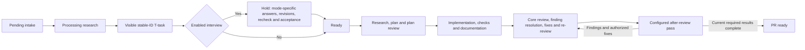

# Plugin Workflow Decisions

## Approval scope

The completed initial task clarification cycle covers fifteen selected tasks, including the owner-requested installed-plugin registry and removal interface. Q1-Q11 have actual owner approval. Approval evidence and selected identities reside in `.skill-tree/history/research/plugin-grill-session.json`. The initial final confirmation binds the exact task and summary fingerprints recorded in the clarification session, separately from individual decision approval.

The subsequent workflow design discussion has actual owner approval for W1. W2 remains open. The [W1 decision record](../history/research/plugin-auto-manual-decision.json) preserves the actual owner submission reference, approved policy and implementation boundary. W1 extends the planned final-acceptance policy with legitimate delegated Auto acceptance; the existing manual-only controller remains the implemented baseline until the required followup passes acceptance.

## Approved decisions

| Decision | Approved policy |
| --- | --- |
| Q1: review role | Ponytail supplies an additional bounded review pass focused on unnecessary complexity and minimal complete changes. Findings enter the ordinary authorized fix/re-review cycle. Before/during/after placement remains configurable. |
| Q2: interview obligation | An enabled post-processing interview is required before implementation. Actual answers, task revisions and readiness rechecks are necessary. Core-only projects receive no mandatory global interview. |
| Q3: initial host scope | Codex is the first verified plugin invocation host. The contract remains portable; other host invocations remain unqualified or unavailable until verified. Core installation support remains unchanged. |
| Q4: recommendation objective | Demonstrated task/review quality improvement has priority. Time, cost and evidence limitations remain explicit. Adoption supplies discovery evidence rather than demonstrated outcome quality. |
| Q5: default review placement | Ponytail defaults to an additional pass after ordinary full review and before PR readiness. Other configured placements preserve the complete core review. |
| Q6: interview visibility | Processing with an enabled interview creates a visible stable-ID T-task under an implementation hold. The task becomes Ready after actual answers, revisions, rechecks and owner confirmation. |
| Q7: configured review completion | An enabled pass must complete for the current review identity before PR readiness. Missing capability, failure or unavailability retains a visible block. Explicit disabling is recorded without claiming execution success. |
| Q8: confirmation freshness | Semantic changes reopen affected answers and final confirmation; unrelated answers remain valid. Formatting-only changes preserve confirmation. Semantic identity covers goals, scope, exclusions, dependencies, acceptance, validation and required plugin policy. |
| Q9: configuration lifetime | Project defaults support explicit temporary per-run overrides. Effective configuration is recorded and frozen across resume. Persistent edits never silently replace parked-run requirements. |
| Q10: recommendation eligibility | Recommended bundles require bounded target-workflow comparison evidence. Compatibility-only or untested candidates remain manually selectable with explicit evidence status. An empty eligible recommendation set is valid. |
| Q11: installation and enablement | A project proposal shows exact versions, hook locations, enabled state and readiness effects. Actual confirmation installs and enables exactly the displayed configuration; execution occurs later in authorized workflows. |

## Installed plugin management

The owner requires a project-local registry showing installed plugin IDs, exact revisions, destinations and every configured operation/hook binding with enabled state. Catalog availability remains distinct from installation state. Human-readable and machine-readable installed views derive from the canonical owned registry.

The management task supplies a documented exact-ID removal command with affected package/binding preview and guarded lifecycle removal. Unknown identities, ownership drift, remaining dependents and parked-run requirements receive explicit outcomes. Removal preserves core packages, unrelated files and historical receipts. Removing a required plugin never establishes successful invocation or silently changes frozen run configuration.

## Remaining research deliverables

The market study owns the current ecosystem map, justified shortlist and bounded comparison plan. Comparative qualification owns observed outcomes and recommendation eligibility. The workflow design task owns concrete proposals for additional stages or operation splits; new structural changes require actual owner agreement. Research deliverables do not presume favorable plugin outcomes or universal host compatibility.

Source research establishes the absence of a generic prompt execution engine and the need for bounded activation, dependency closure and verified adapters. The native Skill tool is unavailable in the current session. The implemented shared clarification controller supports guarded source-backed sessions; the installed standalone Clarify Tasks operation exposes the controller. External plugin invocation remains a separate implementation and qualification deliverable.

The existing validation signature omits full task semantics. The clarification contract separates complete-content write guards from semantic confirmation identity. Manual task revisions preserve immutable terminal outcomes, Pending provenance and parked implementation progress; no implementation run begins through clarification.

## Workflow decisions and remaining proposal

Task `T-a5a738da-c182-4206-bb61-75ffa21946fb` owns the design discussion. W1 approves explicit internal phases and default Auto decision governance inside the current operations. W2 owns the remaining exact plugin-anchor proposal and has no approval effect. The original fifteen root identities and historical terminal outcomes remain unchanged.

The diagram combines approved W1 phases and pilot defaults with the remaining W2 anchor proposal. The diagram supplies no W2 approval. PR creation, publication and merge retain applicable owner authorization. A local implementation result requires no implicit PR action.

### Approved decision W1: internal phases and decision modes

The owner approves the same explicit internal sequence for both modes: research, plan, plan review, implementation, checks, review, finding resolution, fixes and re-review. The phases initially remain inside the existing operations. Separate standalone planning or report-only commands remain a later usage decision. W1 introduces no standalone release/deployment or retrospective operation.

Auto is the approved default decision mode. The executor presents the question, options, recommendation and researched facts. A separate resolver agent studies the context and chooses an option with a recorded rationale. Significant decisions receive an independent critic examining assumptions, omitted consequences and task alignment. Substantive disagreement receives an arbiter; routine decisions require one resolver. Accepted decisions persist before continuation.

Manual is an explicit mode selection. The same questions and recommendations reach the owner in chat, and actual owner replies are awaited at decision checkpoints. Routine authorized work between checkpoints continues. An explicit mode switch preserves accumulated task/session/run state. Frozen effective configuration records the current mode and explicit switch history; a changed project default never silently rewrites a parked run.

Delegated Auto authority covers product and technical choices within agreed goals, scope and constraints, including current clarified-specification acceptance. Out-of-authority requests return to the owner. Existing authorizations remain valid. Actual delegated-agent answers and acceptance retain the real actor, authority, rationale and independent-check evidence. Manual retains actual owner answers and final acceptance. W1 extends Q6 and related answer/confirmation rules only for legitimate delegation; agent output never acquires owner-message provenance.

The automatic review/fix cycle separates the reviewer, resolver and executor roles. The resolver substantiates a finding or rejects the finding with concrete evidence. Accepted findings enter authorized fixes, current required checks and repeated review. Agent agreement supplies decision evidence; actual checks and review establish readiness. Repeated disputes or unchanged failures without progress escalate one concrete owner question. Additional agents or repeated endorsements supply no progress.

### Required W1 implementation handoff

Pending `P-09b5b828-dcdc-4d06-bee1-19e1787e34f4`, priority 128, captures the required Auto/Manual foundation as a blocker of interview consumer `T-657e5621-efb8-4c53-8ab9-bdd2a7e6ec69`. Processing researches decomposition, shared consumer dependencies and qualification after the workflow-design gate. The design task contains no workflow implementation. The completed manual clarification controller and original contracts retain immutable terminal evidence.

| Unfinished consumer | Required specification alignment before implementation |
| --- | --- |
| Composition `T-a9d7a827-fb25-4348-bcf7-867a449c58ef` | Standalone operations carry W1 modes, internal phases and authority routing. Core-only operations receive approved core W1 behavior; optional plugins create no unrelated global obligation. |
| Invocation `T-dae414c5-43e4-45db-a6f3-4ce4112440c5` | Inputs and receipts bind mode, delegation, actual actor/role evidence and explicit mode-switch history while retaining current-source and frozen-scope guards. |
| Review pilot `T-18db6175-499f-4679-bf8d-f815c7b42411` | The pilot participates in finding resolution, authorized fixes and current re-review; delegated decisions preserve mandatory checks and applicable independent approvals. |
| Interview pilot `T-657e5621-efb8-4c53-8ab9-bdd2a7e6ec69` | Auto uses actual bounded delegated answers and final acceptance; Manual uses actual owner answers and confirmation. Acceptance criteria and check mappings change together. |
| Comparison `T-a583acd5-fc6b-4d37-97ec-02df969fea9e` | Both comparison arms freeze the same current W1 core baseline and mode. W1 grants no trial authorization or increased limits. |

Qualification covers both modes, out-of-authority requests, false answer origin, semantic drift, explicit switching and resume, no-progress escalation and actual agent scenarios. Installation consent, package ownership and existing publication boundaries retain applicable authorization. W2 remains an owner decision in the current discussion; the proposed Auto implementation supplies no answer to W2.

### Open decision W2: permitted initial anchor map

All anchors follow mandatory selection, admission, ownership and authorization guards. Each supported operation/phase pair has one deterministic sequential anchor. The general phase vocabulary does not imply support for every operation/phase pair.

| Existing operation | Before | During | After |
| --- | --- | --- | --- |
| Process Pending | After exact Pending selection and guards, before source research. | After source research, before final task formulation. | After atomic creation of visible stable-ID T-tasks with implementation holds, before the processing handoff and interview launch; an enabled interview retains the holds until actual mode-specific answers, revisions, recheck and acceptance. Core-only task creation has no plugin interview hold. |
| Implement Next | After exact task/dependency admission, before selected-task research. | After selected-task research and local planning, before source edits. | After required checks and documentation, before terminal task completion. Verification-oriented plugins may inspect evidence; plugin output never substitutes for required checks. |
| Initialize Documents / Audit Documents | After exact repository/document scope and guards, before source research. | After source research, before document formulation or audit consolidation. | After document updates and required validation, before operation acceptance. An after-hook edit invalidates affected checks. |
| PR Review Cycle | After pinning the complete diff/base/head and authority, before core review analysis. | After the first complete core diff inspection, before finding consolidation and the ordinary fix/re-review cycle. | After the complete core review/fix cycle, before PR readiness and any authorized merge. Ponytail uses the after-review anchor by default. |

`During` contributes an additional declared pass; the plugin cannot replace, interrupt arbitrarily or truncate core work. Changes to the reviewed head/base, relevant source, task semantics or effective configuration invalidate affected results. New authorized fixes repeat the required core review and configured passes for the current identity. Deterministic ordering resolves multiple bindings at the same anchor.

Implement All and Work Through Next reuse the leaf-operation bindings and create no duplicate controller invocation. Add Pending, Create Snapshot, standalone Clarify Tasks and controller-level bindings remain unsupported in the initial map. The post-processing interview uses the shared clarification session rather than invoking the plugin again on every internal question round. Validation is an existing implementation obligation, not a newly invented standalone operation. Additional readiness gates outside the two approved pilot policies require a separate explicit policy decision.

### Separate comparative qualification decision

The market study contains a finite proposal of eight fixtures, 36 worker trials, eight blind judges, eight factual helpers and two activation calibrations: at most 54 spawned contexts, 96 explicit host-turn requests and 60 task-specific minutes. Task `T-a583acd5-fc6b-4d37-97ec-02df969fea9e` owns actual agreement before comparison execution and records the current W1 baseline before freezing trials. W1 approval and any later W2 approval supply no comparison execution authority, favorable recommendation evidence, external acquisition or native/runtime scope.
