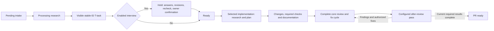

# Plugin Workflow Decisions

## Approval scope

The explicit task clarification cycle covers fifteen selected tasks, including the owner-requested installed-plugin registry and removal interface. Q1-Q11 have actual owner approval. Approval evidence and selected identities reside in `.skill-tree/history/research/plugin-grill-session.json`. The owner confirms shared understanding of the current fifteen-task specification. The final confirmation binds the exact task and summary fingerprints recorded in the clarification session, separately from individual decision approval. The clarification cycle is complete.

## Approved decisions

| Decision | Approved policy |
| --- | --- |
| Q1: review role | Ponytail supplies an additional bounded review pass focused on unnecessary complexity and minimal complete changes. Findings enter the ordinary authorized fix/re-review cycle. Before/during/after placement remains configurable. |
| Q2: interview obligation | An enabled post-processing interview is required before implementation. Actual answers, task revisions and readiness rechecks are necessary. Core-only projects receive no mandatory global interview. |
| Q3: initial host scope | Codex is the first verified plugin invocation host. The contract remains portable; other host invocations remain unqualified or unavailable until verified. Core installation support remains unchanged. |
| Q4: recommendation objective | Demonstrated task/review quality improvement has priority. Time, cost and evidence limitations remain explicit. Adoption supplies discovery evidence rather than demonstrated outcome quality. |
| Q5: default review placement | Ponytail defaults to an additional pass after ordinary full review and before PR readiness. Other configured placements preserve the complete core review. |
| Q6: interview visibility | Processing with an enabled interview creates a visible stable-ID T-task under an implementation hold. The task becomes Ready after actual answers, revisions, rechecks and owner confirmation. |
| Q7: configured review completion | An enabled pass must complete for the current review identity before PR readiness. Missing capability, failure or unavailability retains a visible block. Explicit disabling is recorded without claiming execution success. |
| Q8: confirmation freshness | Semantic changes reopen affected answers and final confirmation; unrelated answers remain valid. Formatting-only changes preserve confirmation. Semantic identity covers goals, scope, exclusions, dependencies, acceptance, validation and required plugin policy. |
| Q9: configuration lifetime | Project defaults support explicit temporary per-run overrides. Effective configuration is recorded and frozen across resume. Persistent edits never silently replace parked-run requirements. |
| Q10: recommendation eligibility | Recommended bundles require bounded target-workflow comparison evidence. Compatibility-only or untested candidates remain manually selectable with explicit evidence status. An empty eligible recommendation set is valid. |
| Q11: installation and enablement | A project proposal shows exact versions, hook locations, enabled state and readiness effects. Actual confirmation installs and enables exactly the displayed configuration; execution occurs later in authorized workflows. |

## Installed plugin management

The owner requires a project-local registry showing installed plugin IDs, exact revisions, destinations and every configured operation/hook binding with enabled state. Catalog availability remains distinct from installation state. Human-readable and machine-readable installed views derive from the canonical owned registry.

The management task supplies a documented exact-ID removal command with affected package/binding preview and guarded lifecycle removal. Unknown identities, ownership drift, remaining dependents and parked-run requirements receive explicit outcomes. Removal preserves core packages, unrelated files and historical receipts. Removing a required plugin never establishes successful invocation or silently changes frozen run configuration.

## Remaining research deliverables

The market study owns the current ecosystem map, justified shortlist and bounded comparison plan. Comparative qualification owns observed outcomes and recommendation eligibility. The workflow design task owns concrete proposals for additional stages or operation splits; new structural changes require actual owner agreement. Research deliverables do not presume favorable plugin outcomes or universal host compatibility.

Source research establishes the absence of a generic prompt execution engine and the need for bounded activation, dependency closure and verified adapters. The native Skill tool is unavailable in the current session. The implemented shared clarification controller supports guarded source-backed sessions; the installed standalone Clarify Tasks operation exposes the controller. External plugin invocation remains a separate implementation and qualification deliverable.

The existing validation signature omits full task semantics. The clarification contract separates complete-content write guards from semantic confirmation identity. Manual task revisions preserve immutable terminal outcomes, Pending provenance and parked implementation progress; no implementation run begins through clarification.

## Concrete workflow proposal awaiting owner decisions

Task `T-a5a738da-c182-4206-bb61-75ffa21946fb` owns the following design discussion. The proposal has no approval or execution effect. Q1-Q11 remain approved independently. The proposed initial map retains the ten current operations and introduces bounded internal plugin anchors rather than additional mandatory global stages.

The diagram shows the approved pilot defaults within the proposed anchor map. PR creation, publication and merge retain separate owner authorization. A local implementation result requires no implicit PR action.

### Decision W1: operation structure

The recommended initial structure preserves the current operations. Planning remains inside the selected implementation operation, with an optional plugin before edits. Core review and ordinary authorized fixes remain one resumable cycle. Additional standalone Design/Plan approval, separate Review Report and Fix operations, controller-level plugins, and new release/deployment or retrospective stages remain deferred.

An alternative standalone Design/Plan stage makes the plan and owner approval more visible, but adds a mandatory or configurable stop, another persisted transition and plan freshness rules. Splitting Review Report from Fix makes report-only runs more explicit, but adds handoff state and another selection boundary. Existing report-only plugin results and the current fix cycle cover the initial pilots without requiring either split. A selected structural alternative requires an exact scope and follow-up decision before implementation.

### Decision W2: permitted initial anchor map

All anchors follow mandatory selection, admission, ownership and authorization guards. Each supported operation/phase pair has one deterministic sequential anchor. The general phase vocabulary does not imply support for every operation/phase pair.

| Existing operation | Before | During | After |
| --- | --- | --- | --- |
| Process Pending | After exact Pending selection and guards, before source research. | After source research, before final task formulation. | After atomic creation of visible stable-ID T-tasks with implementation holds, before the processing handoff and interview launch; an enabled interview retains the holds until actual answers, revisions, recheck and owner confirmation. Core-only task creation retains the existing readiness behavior. |
| Implement Next | After exact task/dependency admission, before selected-task research. | After selected-task research and local planning, before source edits. | After required checks and documentation, before terminal task completion. Verification-oriented plugins may inspect evidence; plugin output never substitutes for required checks. |
| Initialize Documents / Audit Documents | After exact repository/document scope and guards, before source research. | After source research, before document formulation or audit consolidation. | After document updates and required validation, before operation acceptance. An after-hook edit invalidates affected checks. |
| PR Review Cycle | After pinning the complete diff/base/head and authority, before core review analysis. | After the first complete core diff inspection, before finding consolidation and the ordinary fix/re-review cycle. | After the complete core review/fix cycle, before PR readiness and any authorized merge. Ponytail uses the after-review anchor by default. |

`During` contributes an additional declared pass; the plugin cannot replace, interrupt arbitrarily or truncate core work. Changes to the reviewed head/base, relevant source, task semantics or effective configuration invalidate affected results. New authorized fixes repeat the required core review and configured passes for the current identity. Deterministic ordering resolves multiple bindings at the same anchor.

Implement All and Work Through Next reuse the leaf-operation bindings and create no duplicate controller invocation. Add Pending, Create Snapshot, standalone Clarify Tasks and controller-level bindings remain unsupported in the initial map. The post-processing interview uses the shared clarification session rather than invoking the plugin again on every internal question round. Validation is an existing implementation obligation, not a newly invented standalone operation. Additional readiness gates outside the two approved pilot policies require a separate explicit policy decision.

### Separate comparative qualification decision

The market study contains a finite proposal of eight fixtures, 36 worker trials, eight blind judges, eight factual helpers and two activation calibrations: at most 54 spawned contexts, 96 explicit host-turn requests and 60 task-specific minutes. Task `T-a583acd5-fc6b-4d37-97ec-02df969fea9e` owns actual agreement before comparison execution. Approval of W1/W2 alone does not approve the comparison, favorable recommendations, external acquisition or native/runtime execution.
